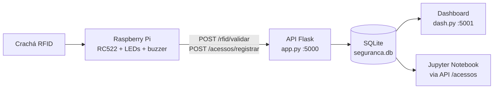
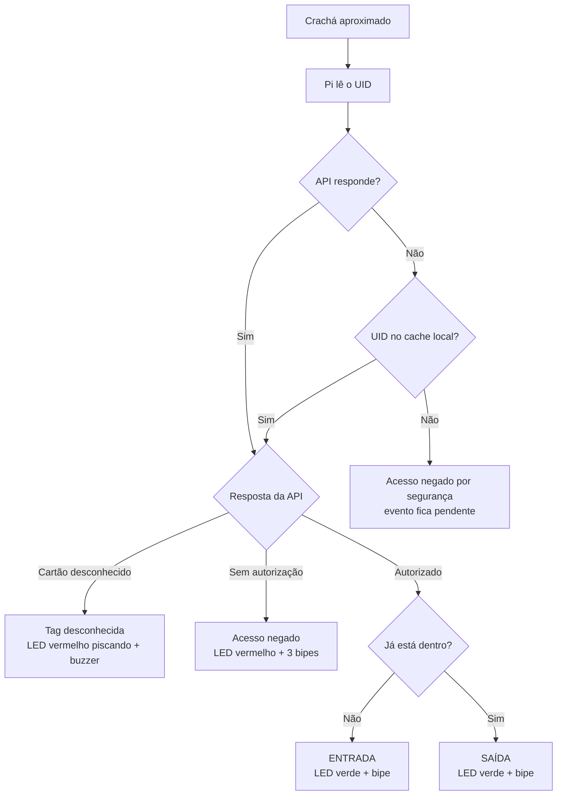

<div align="center">

# Sistema de Segurança RFID

**Controle de acesso com Raspberry Pi, API Flask, dashboard web e análise de dados com Pandas.**


</div>

---

## Sumário

- [Visão geral](#visão-geral)
- [Como funciona](#como-funciona)
- [Tecnologias](#tecnologias)
- [Estrutura do projeto](#estrutura-do-projeto)
- [Montagem do hardware](#montagem-do-hardware)
- [Instalação e execução](#instalação-e-execução)
- [Dashboard de monitoramento](#dashboard-de-monitoramento)
- [Análise de dados (Jupyter)](#análise-de-dados-jupyter)
- [Referência da API](#referência-da-api)
- [Banco de dados](#banco-de-dados)
- [Modo offline](#modo-offline)
- [Autores](#autores)

---

## Visão geral

Sistema de controle de acesso a uma sala (ou laboratório) por **crachás RFID**. Ao aproximar o crachá do leitor, a Raspberry Pi lê o identificador (UID), consulta a API para saber se o cartão está cadastrado e autorizado, e sinaliza o resultado com LEDs e buzzer. Todos os eventos ficam registrados em um banco SQLite, ficam visíveis em um dashboard web e podem ser analisados em um Jupyter Notebook.

O sistema é dividido em quatro componentes:

| Componente | O que faz | Arquivos principais |
|---|---|---|
| **Hardware** | Raspberry Pi com leitor RFID RC522, 2 LEDs e buzzer. Identifica o crachá e sinaliza o resultado. | `sistema_integrado.py`, `cadastro_integrado.py` |
| **Backend e banco de dados** | API Flask que valida credenciais, gerencia colaboradores e cartões e grava os registros no SQLite. | `app.py`, `database.py` |
| **Monitoramento web** | Dashboard com total de entradas, saídas, acessos negados, tags desconhecidas e últimos registros. | `dash.py`, `templates/index.html` |
| **Análise de dados** | Notebook com Pandas para calcular indicadores de acesso e permanência. | `analise_dados.ipynb` |

---

## Como funciona



Decisão tomada a cada leitura de crachá:



### Sinais do hardware

| Situação | LED | Buzzer |
|---|---|---|
| Acesso liberado (entrada ou saída) | Verde aceso por 2 s | 1 bipe curto |
| Acesso negado (sem autorização) | Vermelho | 3 bipes |
| Tag desconhecida (possível invasão) | Vermelho piscando 10x | 10 bipes curtos |
| API indisponível e cartão fora do cache | Vermelho | 3 bipes |

A cada leitura, o evento é gravado em `logs_acesso.csv` (local) e enviado à API (banco SQLite). Ao encerrar com `Ctrl+C`, o sistema imprime um relatório com o tempo de permanência de cada colaborador no dia, as tentativas negadas e as tags desconhecidas.

---

## Tecnologias

- **Python 3.9+**
- **Flask**: API REST e dashboard
- **SQLite**: banco de dados local
- **Pandas + Requests + Jupyter**: análise de dados
- **RPi.GPIO + mfrc522**: leitura RFID e controle de LEDs e buzzer na Raspberry Pi

---

## Estrutura do projeto

```text
projetoRaspberry/
├── app.py                    # API Flask: login, colaboradores, cartões, validação RFID, registros e monitoramento
├── database.py               # Conexão com o SQLite e criação das tabelas (init_db)
├── dash.py                   # Dashboard web (porta 5001) que lê direto do banco
├── templates/
│   └── index.html            # Página do dashboard (cards de resumo + tabela dos últimos acessos)
├── cadastro_integrado.py     # Cliente da API usado pela Raspberry: valida cartão, cache local e fila de pendentes
├── sistema_integrado.py      # Programa principal da Raspberry: lê o RFID, aciona LEDs/buzzer e registra eventos
├── hardware/                 # Versão standalone (sem API), mantida como referência
│   ├── cadastro.py           # Colaboradores fixos em um dicionário Python
│   └── sistema.py            # Mesma lógica do sistema integrado, porém consultando o dicionário local
├── analise_dados.ipynb       # Notebook com os indicadores de acesso e permanência
├── logs_acesso.csv           # Log local de eventos gerado pela Raspberry (dados de exemplo/teste)
├── requirements.txt          # Dependências Python do servidor (Flask e Pandas)
├── .gitignore                # Arquivos ignorados pelo Git
└── README.md                 # Este arquivo
```

---

## Montagem do hardware

### Materiais

- 1x Raspberry Pi (com Raspberry Pi OS e acesso à rede)
- 1x leitor RFID **RC522** (13,56 MHz) com crachás/tags Mifare
- 1x LED verde e 1x LED vermelho
- 2x resistores de 220 Ω (um para cada LED)
- 1x buzzer ativo
- Protoboard e jumpers

### Ligações

O código usa a **numeração física dos pinos** (modo BOARD, definido internamente pela biblioteca `mfrc522`).

**Leitor RC522**

| RC522 | Pino físico da Raspberry | GPIO |
|---|---|---|
| SDA (SS) | 24 | GPIO8 (CE0) |
| SCK | 23 | GPIO11 |
| MOSI | 19 | GPIO10 |
| MISO | 21 | GPIO9 |
| IRQ | não conectar | |
| GND | 6 | GND |
| RST | 22 | GPIO25 |
| 3.3V | 1 | 3V3 |

> O RC522 trabalha com **3,3 V**. Nunca ligue o pino 3.3V do módulo em 5 V.

**LEDs e buzzer**

| Componente | Pino físico | GPIO | Observação |
|---|---|---|---|
| LED verde (`LED_VERDE`) | 11 | GPIO17 | Ligar em série com resistor de 220 Ω |
| LED vermelho (`LED_VERMELHO`) | 13 | GPIO27 | Ligar em série com resistor de 220 Ω |
| Buzzer (`BUZZER`) | 15 | GPIO22 | Buzzer ativo |
| GND dos três | 9 ou 14 | GND | |

Se quiser mudar os pinos, edite as constantes no topo de `sistema_integrado.py`.

---

## Instalação e execução

O projeto roda em **dois lugares**:

- **Servidor** (seu computador ou a própria Raspberry): API, dashboard e notebook.
- **Raspberry Pi**: leitor RFID, LEDs e buzzer.

A API roda na porta **5000** e o dashboard na **5001**. A Raspberry só precisa alcançar a API pela rede.

### 1. Clonar o repositório

```bash
git clone https://github.com/SEU_USUARIO/projetoRaspberry.git
cd projetoRaspberry
```

### 2. Servidor: ambiente Python e dependências

**Linux / macOS**

```bash
python3 -m venv venv
source venv/bin/activate
pip install -r requirements.txt
pip install requests notebook   # necessários para o notebook de análise
```

**Windows (PowerShell)**

```powershell
python -m venv venv
venv\Scripts\Activate.ps1
pip install -r requirements.txt
pip install requests notebook
```

### 3. Servidor: variáveis de ambiente

A API **não inicia** sem estas três variáveis:

| Variável | Descrição |
|---|---|
| `FLASK_SECRET_KEY` | Chave secreta usada para assinar a sessão de login |
| `ADMIN_USUARIO` | Usuário do administrador da API |
| `ADMIN_SENHA` | Senha do administrador da API |

Gere uma chave secreta:

```bash
python -c "import secrets; print(secrets.token_hex(32))"
```

**Linux / macOS**

```bash
export FLASK_SECRET_KEY="cole_a_chave_gerada_aqui"
export ADMIN_USUARIO="admin"
export ADMIN_SENHA="troque_esta_senha"
```

**Windows (PowerShell)**

```powershell
$env:FLASK_SECRET_KEY="cole_a_chave_gerada_aqui"
$env:ADMIN_USUARIO="admin"
$env:ADMIN_SENHA="troque_esta_senha"
```

> O notebook `analise_dados.ipynb` vem com `admin` / `admin123` escritos na primeira célula. Use esses valores em desenvolvimento ou altere a célula para refletir suas credenciais.

### 4. Servidor: iniciar a API

```bash
python app.py
```

O banco `seguranca.db` é criado automaticamente na primeira execução. Teste:

```bash
curl http://localhost:5000/health
# {"servico":"Sistema de Seguranca RFID","status":"online"}
```

### 5. Servidor: iniciar o dashboard (opcional)

Em **outro terminal**, com o ambiente virtual ativado, na mesma pasta do projeto:

```bash
python dash.py
```

Acesse `http://localhost:5001`.

> O dashboard lê o mesmo `seguranca.db` da API. Execute os dois a partir da pasta do projeto.

### 6. Raspberry Pi: preparar o sistema

Habilite a interface SPI (usada pelo RC522) e reinicie:

```bash
sudo raspi-config nonint do_spi 0
sudo reboot
```

Depois de reiniciar, confirme que o SPI está ativo (deve listar `/dev/spidev0.0`):

```bash
ls /dev/spidev*
```

### 7. Raspberry Pi: dependências

```bash
sudo apt update
sudo apt install -y git python3-venv python3-dev

git clone https://github.com/SEU_USUARIO/projetoRaspberry.git
cd projetoRaspberry

python3 -m venv --system-site-packages venv
source venv/bin/activate
pip install mfrc522 RPi.GPIO spidev
```

> **Raspberry Pi 5:** a biblioteca `RPi.GPIO` original não funciona. Troque por `pip uninstall RPi.GPIO && pip install rpi-lgpio`.

A Raspberry **não precisa** instalar Flask nem Pandas. O cliente da API (`cadastro_integrado.py`) usa apenas a biblioteca padrão do Python.

### 8. Raspberry Pi: apontar para a API

Descubra o IP do computador que roda a API:

```bash
# Linux / macOS
hostname -I        # Linux
ipconfig getifaddr en0   # macOS

# Windows
ipconfig
```

Edite `cadastro_integrado.py` e troque a constante `API_BASE`:

```python
API_BASE = "http://192.168.0.10:5000"   # use o IP do SEU servidor, porta 5000
```

Se a API roda na própria Raspberry, use `http://127.0.0.1:5000`.

Verifique a conexão a partir da Raspberry:

```bash
curl http://IP_DO_SERVIDOR:5000/health
```

> Se não conectar, libere a porta 5000 no firewall do servidor e confirme que os dois dispositivos estão na mesma rede.

### 9. Raspberry Pi: iniciar o sistema

```bash
python3 sistema_integrado.py
```

Aproxime um crachá do leitor. Para encerrar, pressione `Ctrl+C`: o relatório do dia é exibido e os pinos GPIO são liberados.

<details>
<summary><b>Opcional: iniciar automaticamente com a Raspberry (systemd)</b></summary>

Crie o arquivo `/etc/systemd/system/rfid.service` (ajuste usuário e caminhos):

```ini
[Unit]
Description=Sistema de controle de acesso RFID
After=network-online.target
Wants=network-online.target

[Service]
User=pi
WorkingDirectory=/home/pi/projetoRaspberry
ExecStart=/home/pi/projetoRaspberry/venv/bin/python sistema_integrado.py
Restart=on-failure

[Install]
WantedBy=multi-user.target
```

Ative:

```bash
sudo systemctl daemon-reload
sudo systemctl enable --now rfid.service
sudo journalctl -u rfid.service -f   # acompanhar os logs
```

</details>

---

## Dashboard de monitoramento

Disponível em `http://IP_DO_SERVIDOR:5001` após executar `python dash.py`.

- **Cards:** total de **entradas**, **saídas**, **acessos negados** e **tags desconhecidas**.
- **Tabela:** os 10 últimos acessos (data e hora, colaborador, UID, evento e resultado).
- **Rota extra:** `GET /acessos` retorna os 100 últimos registros em JSON.

A página não atualiza sozinha. Recarregue o navegador para ver novos eventos.

---

## Análise de dados (Jupyter)

O notebook `analise_dados.ipynb` faz login na API, baixa os registros de `/acessos` para um DataFrame do Pandas e responde:

1. Quantas pessoas entraram na sala em determinado dia?
2. Quantas pessoas saíram da sala em determinado dia?
3. Quanto tempo um colaborador permaneceu na sala em determinado dia?
4. Quantas tentativas de acesso negado ocorreram?
5. Quantas tentativas com tags desconhecidas (possível invasão) ocorreram?
6. Quais colaboradores não autorizados mais tentaram acessar a sala?

Para executar:

```bash
jupyter notebook analise_dados.ipynb
```

Antes de rodar, ajuste na primeira célula e nas seguintes:

| O que | Onde | Padrão |
|---|---|---|
| Endereço da API | `url_base` | `http://127.0.0.1:5000` |
| Usuário e senha | `sessao.post(... json={...})` | `admin` / `admin123` |
| Dia analisado | `dia` | `"2026-10-28"` (formato `AAAA-MM-DD`) |
| Colaborador do tempo de permanência | `matricula` | `"MAT001"` |

A API precisa estar rodando para o notebook funcionar.

---

## Referência da API

Base: `http://IP_DO_SERVIDOR:5000`. As rotas marcadas com **Login** exigem sessão de administrador (cookie obtido em `POST /login`).

| Método | Rota | Acesso | Descrição |
|---|---|---|---|
| `GET` | `/` | Público | Página inicial com a lista de rotas |
| `GET` | `/health` | Público | Verifica se a API está online |
| `POST` | `/login` | Público | Autentica o administrador (`usuario`, `senha`) |
| `POST` | `/logout` | Login | Encerra a sessão |
| `GET` | `/colaboradores` | Login | Lista colaboradores com o UID do cartão |
| `POST` | `/colaboradores` | Login | Cadastra colaborador (`matricula`, `nome`, `funcao`, `autorizado`) |
| `PUT` / `PATCH` | `/colaboradores/<id>` | Login | Edita campos do colaborador (inclusive `autorizado` e `ativo`) |
| `DELETE` | `/colaboradores/<id>` | Login | Desativa o colaborador e o cartão (exclusão lógica) |
| `POST` | `/cartoes` | Login | Vincula um cartão (`uid`, `colaborador_id`) |
| `PUT` / `PATCH` | `/colaboradores/<id>/cartao` | Login | Cadastra ou troca o cartão do colaborador (`uid`) |
| `POST` | `/rfid/validar` | Público | Valida um UID e informa se o acesso é permitido |
| `POST` | `/acessos/registrar` | Público | Registra um evento de acesso |
| `GET` | `/acessos` | Login | Últimos 100 registros |
| `GET` | `/monitoramento` | Login | Indicadores, últimos acessos, quem está na sala e alertas recentes |

### Exemplo: resposta de `POST /rfid/validar`

```json
{
  "permitido": true,
  "motivo": "autorizado",
  "mensagem": "Acesso permitido.",
  "colaborador": { "id": 1, "matricula": "MAT001", "nome": "Alice", "funcao": "Pesquisadora" }
}
```

Valores possíveis de `motivo`: `autorizado`, `acesso_nao_autorizado`, `colaborador_inativo` e `cartao_desconhecido`.

### Exemplo: corpo de `POST /acessos/registrar`

```json
{
  "uid": "702970395839",
  "evento": "entrada",
  "resultado": "permitido",
  "data_hora": "2026-10-28T08:30:00-03:00",
  "evento_id": "d3b07384-d9a0-4c3e-a2b1-0f3c8e2a9c11"
}
```

- `evento`: `entrada`, `saida`, `negado` ou `desconhecido`
- `resultado`: `permitido` ou `negado`
- `data_hora` e `evento_id` são opcionais. O `evento_id` evita duplicidade quando um evento pendente é reenviado.

---

## Banco de dados

SQLite (`seguranca.db`), criado por `database.py`.

| Tabela | Campos principais | Descrição |
|---|---|---|
| `colaboradores` | `id`, `matricula` (única), `nome`, `funcao`, `autorizado`, `ativo`, `criado_em` | Pessoas cadastradas |
| `cartoes_rfid` | `id`, `uid` (único), `colaborador_id` (único), `ativo` | Um cartão por colaborador |
| `registros_acesso` | `id`, `colaborador_id`, `uid`, `evento`, `resultado`, `registrado_em`, `evento_id` (único) | Histórico de todos os eventos |

Para zerar tudo, pare a API e o dashboard e apague o arquivo `seguranca.db`. Ele será recriado na próxima execução.

---

## Modo offline

Se a Raspberry perder a conexão com a API:

1. **Cache local:** cada resposta da API é guardada em `cache_rfid.json`. Se a API estiver fora do ar e o cartão estiver no cache, o acesso é decidido com base nessa última resposta.
2. **Cartão fora do cache:** o acesso é **negado por segurança**.
3. **Fila de pendentes:** eventos que não puderam ser enviados ficam em `acessos_pendentes.json` e são reenviados quando a API voltar a responder.
4. **Sem duplicidade:** cada evento pendente carrega um `evento_id` único, então a API ignora reenvios repetidos.
5. **Log local:** todos os eventos também são gravados em `logs_acesso.csv`.

Esse funcionamento depende de o cartão já ter sido consultado com a API online ao menos uma vez, e da correta sincronização com a API. Alterações de permissão feitas no servidor só chegam à Raspberry quando ela voltar a se comunicar com a API.

---

## Autores

Desenvolvido por:
  - Thaise Zanin - Hardware e Raspberry Pi
  - Alice Segatto - Backend, API e banco de dados
  - Ana Amaral - Sistema web de gerenciamento
  - Aline Hoffmann - Monitoramento e análise de dados
  - Pedro Segatto - Testes e documentação
